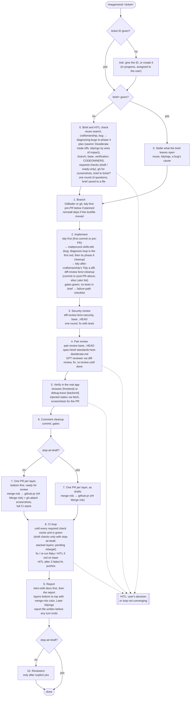
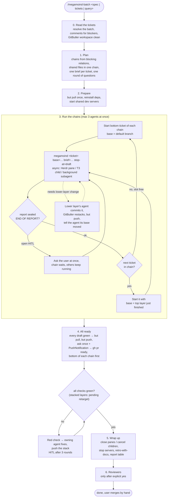

# Megamoind flows

Reference diagrams for [`megamoind`](../skills/engineering/megamoind/SKILL.md) and [`megamoind-batch`](../skills/engineering/megamoind-batch/SKILL.md). The `SKILL.md` files are the source of truth; update these diagrams when a step changes.

## megamoind: one ticket

## megamoind-batch: several tickets

